# 知识图谱：Convolutional Filters（ch10-2）

> 基于《CONVOLUTIONAL NETWORKS》第 10.2 节内容整理  
> 适用工具：Typora、Obsidian、VS Code、GitHub、Notion 等支持 Mermaid 的 Markdown 环境

---

## 1. 本节知识总览

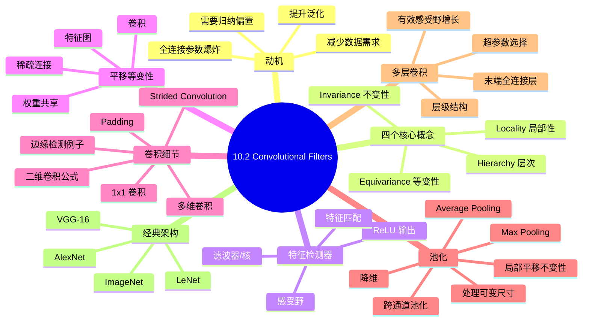

---

## 2. 核心动机：为什么需要卷积网络

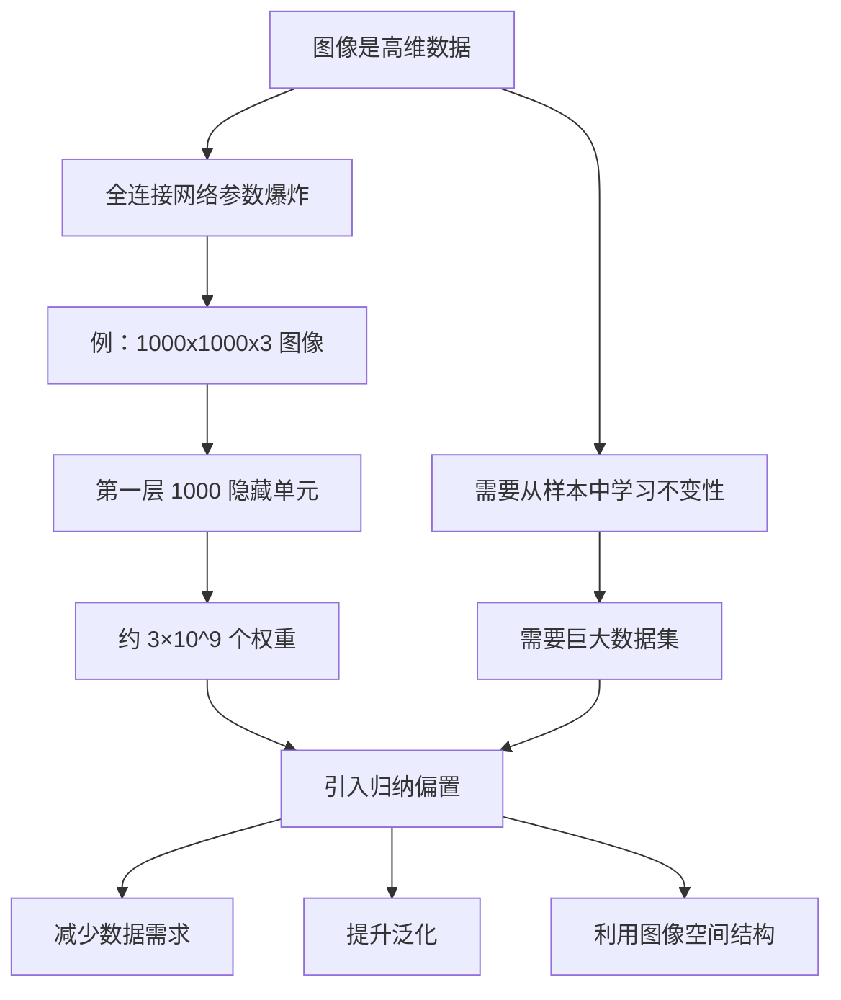

---

## 3. 四个 interrelated concepts

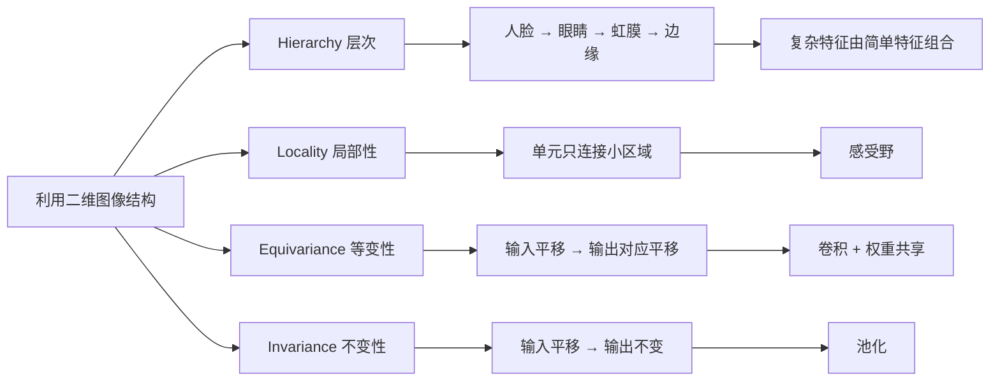

---

## 4. 特征检测器与感受野

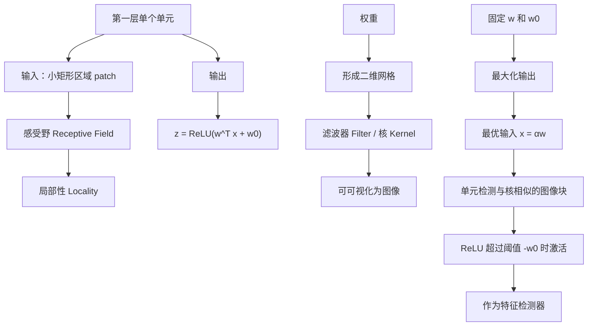

---

## 5. 平移等变性 Translation Equivariance

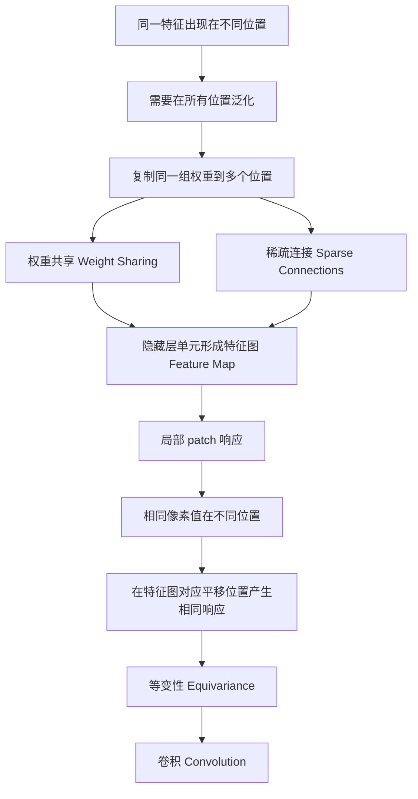

---

## 6. 二维卷积

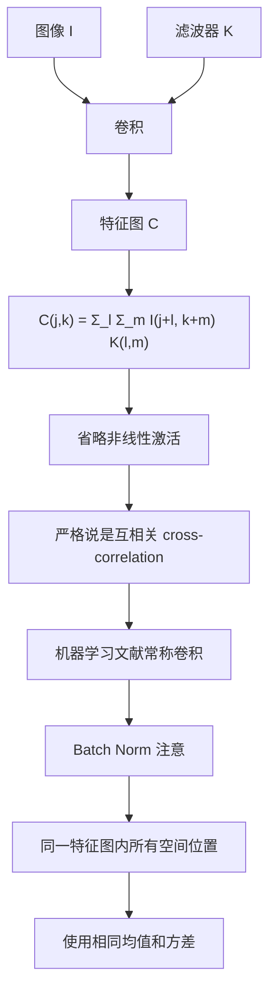

---

## 7. 边缘检测示例

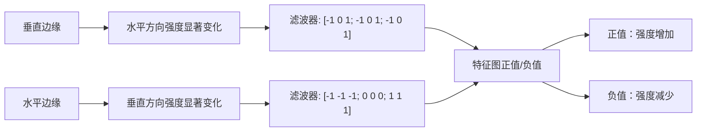

---

## 8. 卷积相比全连接的优势

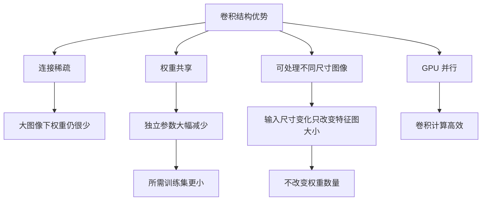

---

## 9. Padding

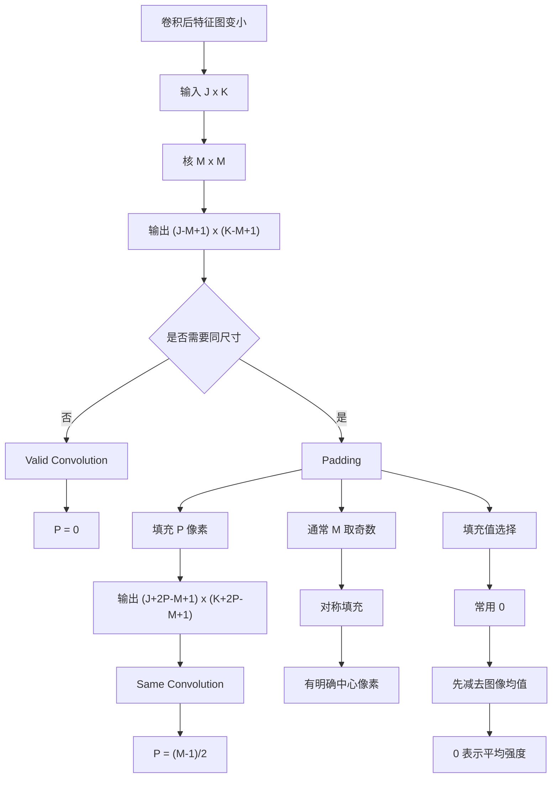

---

## 10. Strided Convolutions

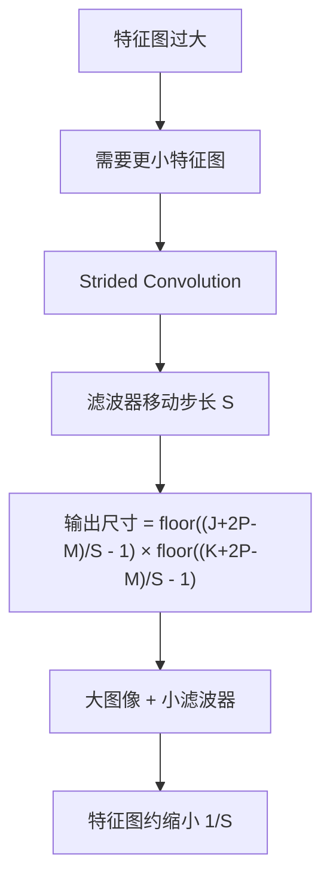

---

## 11. 多维卷积与多通道

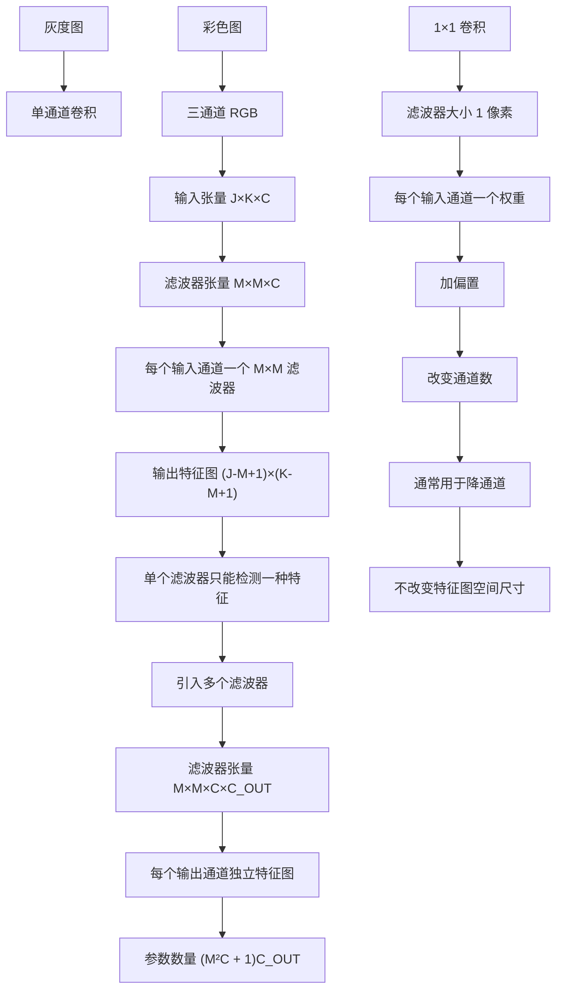

---

## 12. 池化 Pooling

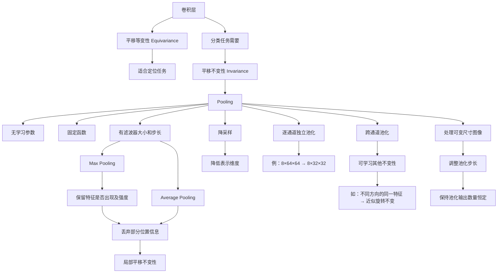

---

## 13. 多层卷积

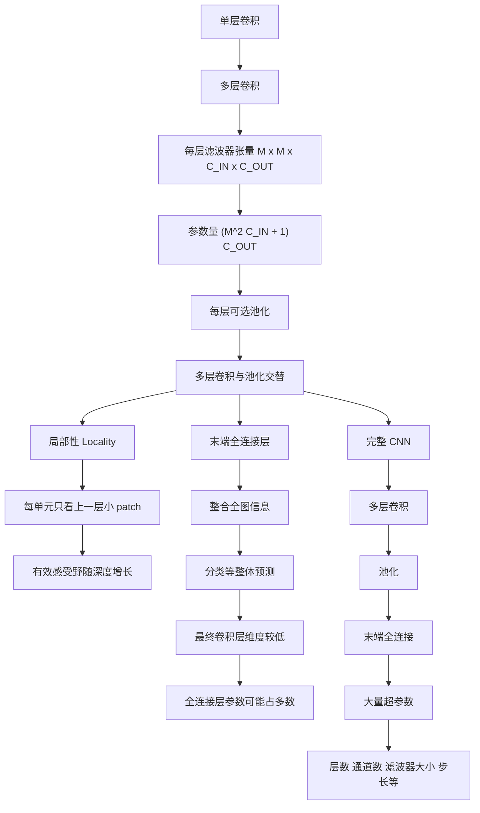

---

## 14. 有效感受野随深度增长

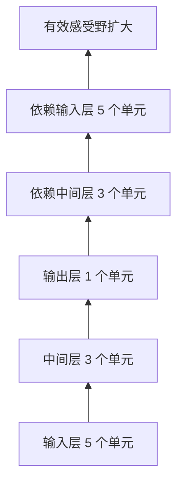

---

## 15. 经典网络架构

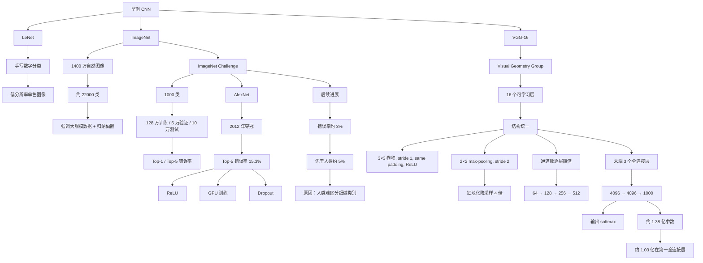

---

## 16. 大感受野 vs 多层小感受野

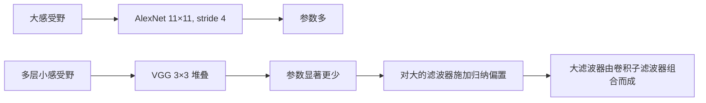

---

## 17. 关键概念索引

| 概念 | 所属主题 | 说明 |
|---|---|---|
| 归纳偏置 | 动机 | 利用图像结构减少参数和数据需求 |
| Hierarchy | 四个核心概念 | 复杂特征由简单特征逐层组合 |
| Locality | 四个核心概念 | 单元只连接输入的小局部区域 |
| Equivariance | 四个核心概念 | 输入平移导致输出对应平移 |
| Invariance | 四个核心概念 | 输入平移时输出保持不变 |
| 感受野 | 特征检测器 | 单元所连接输入图像的小区域 |
| 滤波器 / 核 | 特征检测器 | 权重形成的二维网格，可可视化 |
| 特征检测器 | 特征检测器 | 匹配核模式时产生强响应 |
| 权重共享 | 平移等变性 | 同一组权重在多个位置复用 |
| 稀疏连接 | 平移等变性 | 大多数连接不存在 |
| 特征图 | 平移等变性 | 共享权重的隐藏单元形成的图 |
| 卷积 | 卷积机制 | 局部加权求和，实现等变性 |
| Cross-correlation | 卷积机制 | 严格数学定义下与卷积略有差异 |
| Padding | 卷积细节 | 填充像素以控制输出尺寸 |
| Valid Convolution | Padding | P = 0，输出尺寸变小 |
| Same Convolution | Padding | P = (M-1)/2，输出与输入同尺寸 |
| Strided Convolution | 卷积细节 | 用步长 S 移动滤波器，实现降采样 |
| 多维卷积 | 卷积细节 | 对多通道输入使用 M×M×C 滤波器 |
| 多滤波器 | 卷积细节 | 每个滤波器产生一个输出通道 |
| 1×1 卷积 | 卷积细节 | 改变通道数，不改变空间尺寸 |
| Pooling | 池化 | 无学习参数的固定函数 |
| Max Pooling | 池化 | 取感受野最大值 |
| Average Pooling | 池化 | 取感受野平均值 |
| 局部平移不变性 | 池化 | 对小范围平移不敏感 |
| 跨通道池化 | 池化 | 可学习旋转等其他不变性 |
| 多层卷积 | 多层结构 | 卷积与池化交替堆叠 |
| 有效感受野 | 多层结构 | 随深度增加而扩大 |
| 末端全连接层 | 多层结构 | 整合全图信息做整体预测 |
| LeNet | 经典架构 | 早期手写数字分类 CNN |
| ImageNet | 经典架构 | 大规模图像分类基准 |
| AlexNet | 经典架构 | 2012 年 ImageNet 冠军 |
| VGG-16 | 经典架构 | 结构统一、3×3 卷积堆叠的经典 CNN |

---

## 18. 本节总结

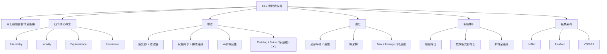
---
